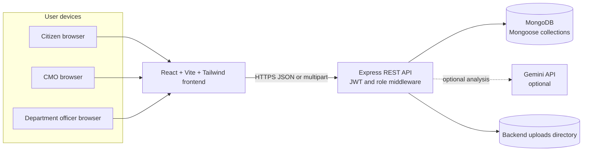
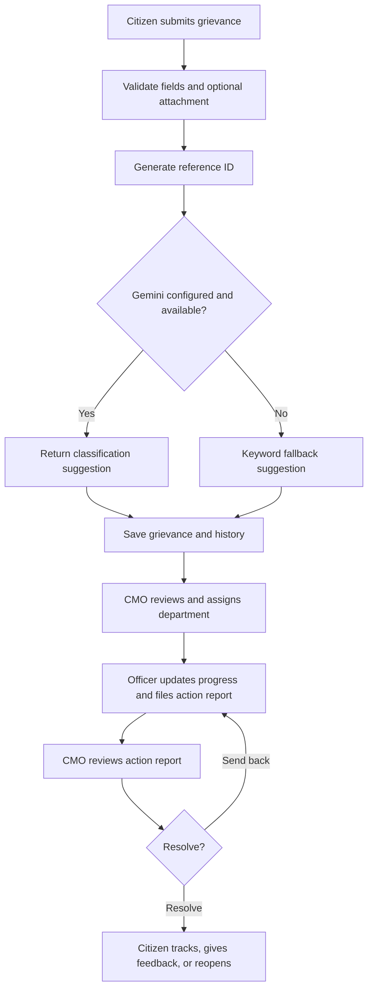

# 02 — System Architecture

## Components

- **Frontend:** React single-page application built with Vite. Tailwind CSS utility classes provide styling. Axios sends requests to the backend API.
- **Backend:** Node.js and Express REST API. Routes handle authentication, public data, AI analysis, grievance workflow and administration. Middleware checks JWT authentication and role permissions.
- **Database:** MongoDB accessed through Mongoose models for users, departments, grievances and contact enquiries.
- **AI:** Optional server-side Gemini `generateContent` call. When no key is configured or a call fails, keyword-based fallback logic is used.
- **File uploads:** Multer stores allowed attachments under `backend/uploads` using generated filenames.

## System architecture diagram

## API architecture

The API base path is `/api`. Route groups are mounted in `backend/server.js`:

| Route group | Responsibilities |
|---|---|
| `/api/auth` | Citizen registration, login and current-user lookup. |
| `/api/ai` | Optional complaint classification suggestion. |
| `/api/grievances` | Submission, tracking, role-based listing, assignment, status, reports and feedback. |
| `/api/admin` | CMO dashboard statistics and officer listing. |
| `/api` | Public departments, metadata, public statistics and contact enquiries. |

## Request and access flow

1. The browser sends requests to the backend URL configured by `VITE_API_URL`.
2. Public endpoints accept requests without a token. Protected endpoints require `Authorization: Bearer <JWT>`.
3. JWT middleware identifies the user; role middleware limits actions to citizens, CMO users or officers.
4. Mongoose reads and writes the MongoDB collections.
5. On grievance submission, the AI suggestion (when available) is advisory. The submitted grievance is stored and receives a reference ID and history entry.

## Grievance workflow diagram

## AI and fallback boundary

The AI key is read only by the backend. The model output is checked against supported department, category and priority values. If it is unavailable or invalid, the application uses keyword fallback rules. AI does not assign work or resolve grievances on its own.
