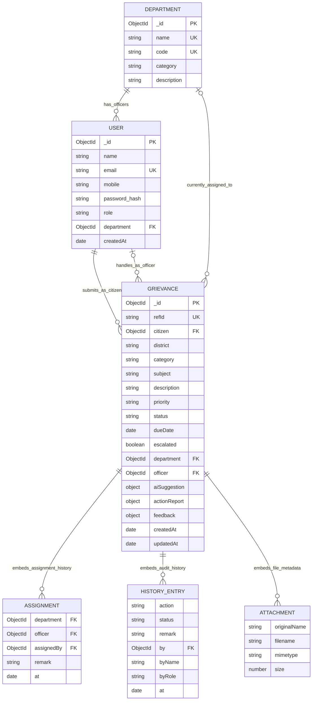

# 03 — Database Design

The application uses MongoDB collections through Mongoose. ObjectId values connect users, departments and grievances. History entries, assignments, attachments, internal remarks, AI suggestions, action reports and feedback are embedded in the grievance document.

## Entity relationship diagram

`ASSIGNMENT`, `HISTORY_ENTRY`, and `ATTACHMENT` in the diagram are embedded subdocuments, not separate MongoDB collections. Each history record may refer to a user by ObjectId, but that reference is not enforced as a relational foreign key by MongoDB.

## Collections and important fields

### User

Fields: `name`, unique normalized `email`, `mobile`, bcrypt-hashed `password`, `role` (`citizen`, `cmo`, `officer`), optional officer `department`, timestamps. Passwords are hashed in a Mongoose pre-save hook.

### Department

Fields: unique `name`, unique `code`, `category`, and `description`. Department classification keywords are defined in backend configuration, not stored in this collection.

### Grievance

Fields include unique `refId`, citizen reference, district, category, subject, description, priority, status, due date, escalation flag, current department/officer, assignment history, audit history, attachment metadata, optional AI suggestion, internal CMO remarks, action report, feedback, timestamps, and computed `isOverdue` virtual.

Allowed statuses are `Submitted`, `Under Review`, `In Progress`, `Resolved`, and `Reopened`. Allowed priorities are `Low`, `Medium`, and `High`.

### Contact

Fields: `name`, `email`, `subject`, `message`, and timestamps. Contact enquiries do not require a user account.

## Relationships

- A citizen can submit many grievances; each grievance has one citizen.
- An officer may belong to a department; a grievance may have one current department and optional current officer.
- A grievance embeds zero or more assignment and history records.
- Contact enquiries are independent of user accounts.
