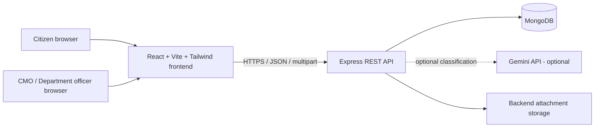
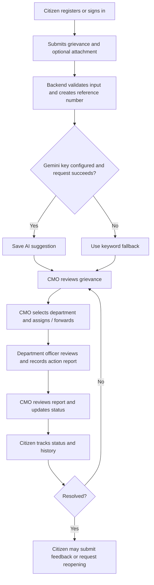

# System Architecture and Workflow

## Components

- **React + Vite + Tailwind CSS frontend**: public information pages, citizen submission and tracking, and role-based CMO/officer dashboards.
- **Express API**: authentication, public endpoints, grievance workflow, uploads, administrative data, and optional AI analysis.
- **MongoDB + Mongoose**: users, departments, grievances, and contact enquiries.
- **Gemini API (optional)**: suggests a grievance department, category, priority, and summary. Keyword fallback is used when the key is missing or the request fails.

## Architecture diagram

## Grievance workflow

## Access and security

- JWT bearer tokens protect authenticated routes.
- Route middleware restricts actions to citizen, CMO, or officer roles.
- Passwords are hashed with bcrypt before storage.
- Helmet and CORS middleware are enabled in the Express app.
- The Gemini API key and database URI belong only in the backend environment.
- Public tracking is by grievance reference ID; private grievance details and attachments require authentication and authorization.
