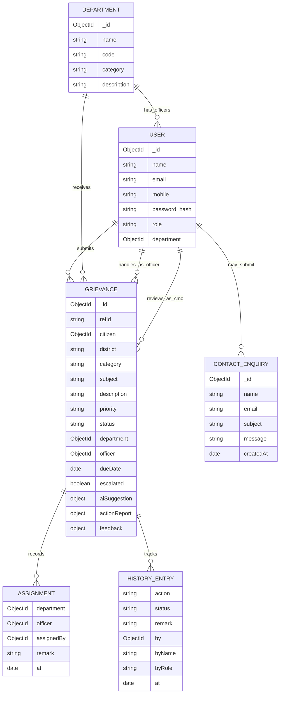

# Database Design

MongoDB stores the application data in four Mongoose collections. ObjectId references connect grievances to their citizens, departments, and assigned officers.

## Entity relationship diagram

## Collection notes

- **User**: Citizen, CMO, or officer account. Password is hashed by a Mongoose pre-save hook; it is never returned by the authentication response.
- **Department**: Government department catalogue. Officer accounts reference their department.
- **Grievance**: Main complaint record with reference ID, status, priority, current assignment, AI suggestion, attachments, action report, feedback, internal remarks, and embedded history/assignment records.
- **Contact**: Public contact form enquiries.

The diagram shows logical relations. `Assignment` and `HistoryEntry` are embedded subdocuments inside each grievance, not separate MongoDB collections.
